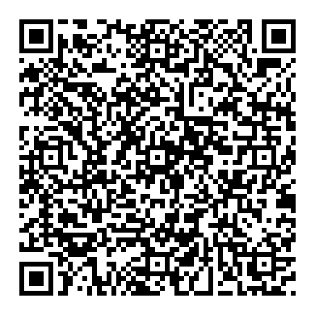

# AD&C Quick Start（コンセプト副題：AgentOS-C）

**AD&C — AI-DODAI & Continuity**：AIの外に、自分の知識や作業履歴を残すための導入手順です。DODAIは日本語の「土台」に由来します。**AgentOS-C（AIをエージェントにするOS）**は旧製品名を引き継いだ設計上の副題で、実際のOSではありません。

**名称変更済み（2026-10-14）：** 本体リポジトリ名は `AI-DODAI-Continuity` になりました。既存配布ガイドのファイル名と、初期出力名 `AgentOS-C_initial.zip` は互換性のため変更していません。[移行計画](docs/ADNC_NAME_MIGRATION_PLAN.md)を参照してください。

## 1. QR画像をAIに送る（初心者向けの第一入口）

[](https://raw.githubusercontent.com/Yosio-DMZ-C/AI-DODAI-Continuity/main/docs/AgentOS-C_%E8%A8%AD%E8%A8%88%E3%83%BB%E6%A7%8B%E7%AF%89%E9%81%8B%E7%94%A8%E6%8C%87%E7%A4%BA%E6%9B%B8_%E4%B8%80%E8%88%AC%E9%85%8D%E5%B8%83%E7%89%88.md)

**[QR画像を開いて保存](assets/adnc-installer-qr.png)し、普段のAIへ写真として送って `これを実行して` と伝えます。** QRには[現行の単一インストーラーMarkdown本文](https://raw.githubusercontent.com/Yosio-DMZ-C/AI-DODAI-Continuity/main/docs/AgentOS-C_%E8%A8%AD%E8%A8%88%E3%83%BB%E6%A7%8B%E7%AF%89%E9%81%8B%E7%94%A8%E6%8C%87%E7%A4%BA%E6%9B%B8_%E4%B8%80%E8%88%AC%E9%85%8D%E5%B8%83%E7%89%88.md)への直リンクが含まれています。GitHubの操作やURLの手入力は不要です。

無料／有料・AIの種類によってインストーラーを選ぶ必要はありません。保存先への実際の読書き可否でクラウド連携／ローカル手動保存に分岐します。

## 2. 本文取得を確認して導入を進める

AIによるQR画像の認識と、**正式なインストーラー本文全文の取得**は別工程です。ファイル名と配布版を確認させてください。404等で取得できない場合は、[README](README.md)の正式入口を一度再確認し、名前の似た別文書を自動的に実行しないでください。

QR画像を読めない、または本文取得ができないAIでは、[現行の単一Markdownファイル](docs/AgentOS-C_設計・構築運用指示書_一般配布版.md)をダウンロードして添付し、`実行` と送ります。添付できなければ本文全文を貼り付けます。[ファイル添付の補足](docs/wiki/Upload-File.md)

**社内Copilot等で外部Markdownにアクセスできない場合**は、[ZIP一括キット](https://github.com/Yosio-DMZ-C/AI-DODAI-Continuity/releases/download/guides-current/ADNC_Offline_Installer_Current.zip)を人間が取得して添付します。ZIPを開けない環境なら[単一Markdown代替](https://github.com/Yosio-DMZ-C/AI-DODAI-Continuity/releases/download/guides-current/ADNC_Offline_Installer_Current.md)を添付してください。いずれも初期KBそのものではなく導入資料です。社内の許可された経路で渡してください。

正式本文を取得できたら、AIはまず保存先を尋ねます。接続・読書きの確認後、AIが作成案を提示します。問題がなければ次を送ります。

```text
進めて
```

**Muse試験（2026-11-01、利用者提供画像）**：GitHubへのリンクを404と報告して別文書へ誘導した事例がありました。その後の人力での導入成功は本人報告で、初期KB実体・別AIからの読戻しは独立未検証です。QR方式の全AIでの成功を意味しません。

## 3. できあがった知識ベースを保存する

- **クラウド連携モード：** 指定したクラウド上のフォルダと主要ファイルが実際に作られているか確認します。
- **添付ファイル中心の場合：** AIが作成した `AgentOS-C_initial.zip`（または復元できるMarkdown/TXT）を取得し、自分のPC・スマホや非公開クラウドへ保管します。

ZIPが出力されない場合やファイルを受け取れない場合は、AIに状況を伝え、使える別の形式を確認してください。

**任意：動画をシリーズで制作したい場合**は、KB作成後に「動画の初期設定もしたい」と伝えると、採用見本PPTX・色・ロゴ・音声方式の参照を非公開KBへまとめる手順を利用できます（[公開Draft手順](https://github.com/Yosio-DMZ-C/AD-C-Shared-Knowledge/blob/main/skills/video-production-setup/SKILL.md)）。通常の導入には不要です。実PPTやロゴをGitHubへ公開する必要はありません。

## 4. 続きから使うには

保存したファイルを次のチャットに渡すところから試せます。再読込や更新ができる範囲はAI環境によって異なるため、元のバックアップを残したまま試してください。

次回は、接続できる保存先の**このKBの入口**（クラウドなら本人が選んだ非公開フォルダURL、ローカルなら保存済みZIP／ファイル一式）を渡し、次の一文で始められます。**AIが自動で保存先を知る保証はありません**。

> このKBの `START_HERE.md`、`BUILD_PLAN.md`、`00_system/registry.json` を実際に取得し、現在の採用条件・完了済み範囲・次に行う1件を確認して続きを進めてください。実取得できない範囲は未確認として扱い、旧版からの全量上書きをしないでください。

既存KBの版更新は再インストールせず、[更新専用入口](docs/updates/UPDATE.md)を使います。

より詳しくは[導入ガイド](docs/wiki/Getting-Started.md)と[実動作の結果](docs/wiki/Verified-Results.md)を参照してください。
